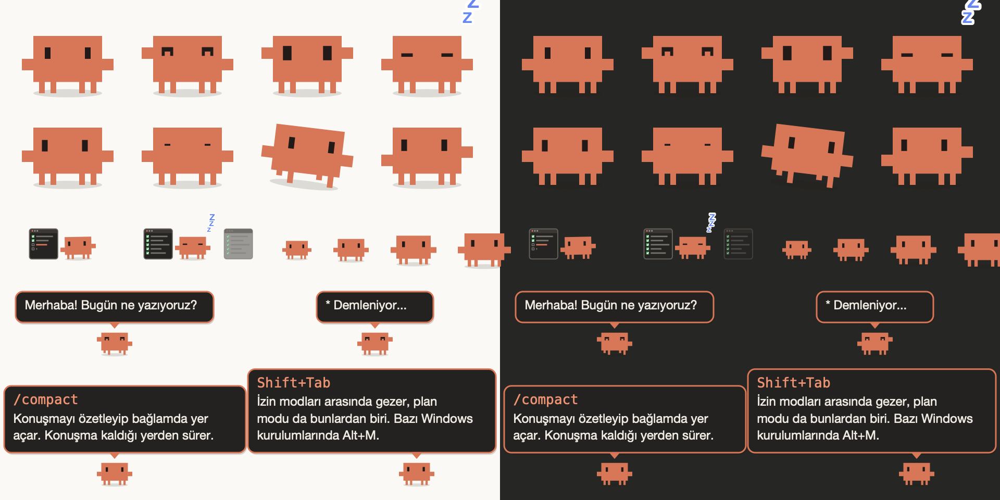
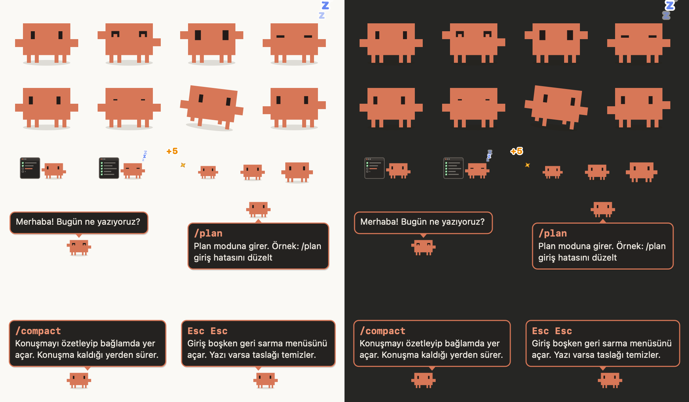

# Clawd

Ekranda duran minik bir masaüstü karakteri. Claude Code'un açılış ekranındaki turuncu piksel karakterden (Clawd) esinlenen, **resmi olmayan** bir hayran çalışmasıdır. Windows ve macOS için iki ayrı sürümü var.



## Ne yapar

- **Tıklayınca** sevinir, konsol görünümlü bir balonda bir söz söyler ve yana yana koşup geri gelir.
- **Claude öndeyken** arada bir Claude Code komutu ya da kısayolu önerir. Örneğin `/compact`: "Konuşmayı özetleyip bağlamda yer açar."
- **3 dakika dokunmazsan** yanında bir iş listesi açar, satırları yazıp işaretler ve bitince uyur. Claude öndeyken uyumaz.
- **Sürükleyince** bıraktığın yeri hatırlar.
- **Sağ tık menüsünden** hemen bir öneri isteyebilir, önerileri kapatabilir, sıklığını ve boyutunu seçebilir, bilgisayar açılınca başlamasını sağlayabilirsin.

Claude uygulaması öndeyse mesaj kutusunun üstüne çıkar. Öbür zamanlarda Windows'ta görev çubuğunun üstünde, macOS'ta menü çubuğunda çentiğin yanında durur.

## Durum

| Sürüm | Durum |
| --- | --- |
| Windows | Bir Mac'te çapraz derlendi, çizimleri orada denetlendi. **Gerçek bir Windows bilgisayarda henüz denenmedi.** |
| macOS | Apple işlemcili bir MacBook Air'de derlendi, kuruldu ve denendi. Başka Mac'lerde denenmedi. |

Pencere davranışı, önerilerin zamanlaması ve balonun yeri senin bilgisayarında farklı çıkabilir. Bir sorun görürsen bir kayıt açabilirsin.

## Windows

1. Depoyu indir (Code, Download ZIP) ve klasörü kalıcı bir yere koy.
2. `Clawd.exe` dosyasına çift tıkla.

Windows "bilinmeyen yayıncı" uyarısı verirse "Ek bilgi" yazısına, sonra "Yine de çalıştır" düğmesine bas. Hazır `Clawd.exe` dosyasına güvenmek istemezsen `derle.bat` dosyasına çift tıkla: programı senin bilgisayarında `Clawd.cs` kaynağından yeniden derler. Windows 10 ve 11'in içindeki C# derleyicisini kullanır, ayrıca bir şey kurmak gerekmez.

Sorun olursa `tanilama.bat` günlük tutarak başlatır (`clawd-gunluk.txt`). Kaldırmak için Clawd'a sağ tıklayıp "Clawd'ı kapat" de ve klasörü sil. Ayarlar `%APPDATA%\Clawd` klasöründe durur.

## macOS

Hazır uygulama yok, kaynaktan derlenir. Xcode Komut Satırı Araçları gerekir (`xcode-select --install`). Betik Apple işlemcili Mac'ler için derler (macOS 13 ve üstü).

```bash
cd mac
./derle.sh kur
```

Bu komut uygulamayı derler, `~/Applications/Clawd.app` olarak kurar ve başlatır. Yalnızca derlemek için `./derle.sh` yeterlidir (`mac/build/Clawd.app`).

İlk açılışta macOS Erişilebilirlik izni sorar. İzin verirsen Clawd, Claude'daki mesaj kutusunun yerini bulup tam üstüne basar; vermezsen yerini pencerenin ölçüsünden tahmin eder ve yine çalışır. Uygulama her yeniden derlendiğinde macOS bu izni yeniden ister.

Kaldırmak için Clawd'a sağ tıklayıp "Clawd'ı kapat" de ve `~/Applications/Clawd.app` dosyasını sil.



## Öneriler nereden geliyor

45 öneri var: 30 komut, 15 kısayol ve giriş kolaylığı. Hepsi Claude Code'un resmi belgelerinden alındı ([commands](https://code.claude.com/docs/en/commands), [interactive mode](https://code.claude.com/docs/en/interactive-mode); Kasım 2026). Komutlar sürümle değişebilir. Bir komut sende yoksa `/help` güncel listeyi gösterir. Kısayollar terminaldeki Claude Code içindir; masaüstü uygulamasında bir kısmı farklı çalışabilir.

## "Claude önde" nasıl anlaşılıyor

Bu bir tahmindir. Clawd şu iki durumda öneri verir:

- Öndeki pencere Claude uygulamasıysa.
- Öndeki pencere bir terminal ya da düzenleyiciyse (Windows Terminal, PowerShell, Terminal, iTerm2, VS Code gibi) ve bilgisayarda bir `claude` süreci çalışıyorsa. Windows'ta pencere başlığında "claude" geçmesi de yeterlidir.

Claude arka planda açıkken başka bir iş için terminal kullanırsan da öneri çıkabilir.

Mesaj kutusunun yerini bulmak için Windows'ta UI Automation, macOS'ta Erişilebilirlik arayüzü kullanılır. Yalnızca öğe türü ve çerçeve okunur; yazdıkların okunmaz, hiçbir şeye basılmaz. Program internete bağlanmaz.

## Dosyalar

| Dosya | Ne |
| --- | --- |
| `Clawd.cs` | Windows sürümünün bütün kaynağı (C# 5, .NET Framework 4.8, WinForms) |
| `Clawd.exe` | Derlenmiş Windows programı |
| `Clawd.ico` | Windows simgesi |
| `derle.bat` | Windows'ta yeniden derler ve başlatır |
| `tanilama.bat` | Windows'ta günlük tutarak başlatır |
| `derle-mac.sh` | Windows sürümünü macOS ya da Linux'ta çapraz derler |
| `mac/Sources/` | macOS sürümünün kaynağı (Swift, AppKit) |
| `mac/derle.sh` | macOS sürümünü derler ve kurar |
| `LICENSE` | MIT lisansı |

## Lisans ve yasal not

Bu depodaki kod [MIT lisansı](LICENSE) ile sunulur.

Lisans yalnız kodu kapsar. Clawd, Claude Code'un maskotudur; Claude, Claude Code ve Clawd Anthropic'e aittir ve bu lisansın kapsamında değildir. Bu depo Anthropic ile bağlantılı değildir ve Anthropic tarafından onaylanmamıştır. Karakter Claude Code'un açılış ekranındaki blok harflerden yola çıkılarak kodla yeniden çizildi.

Kod Claude Code ile birlikte yazıldı.
